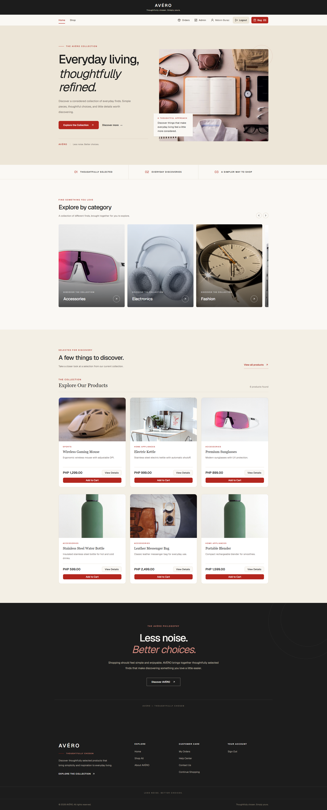
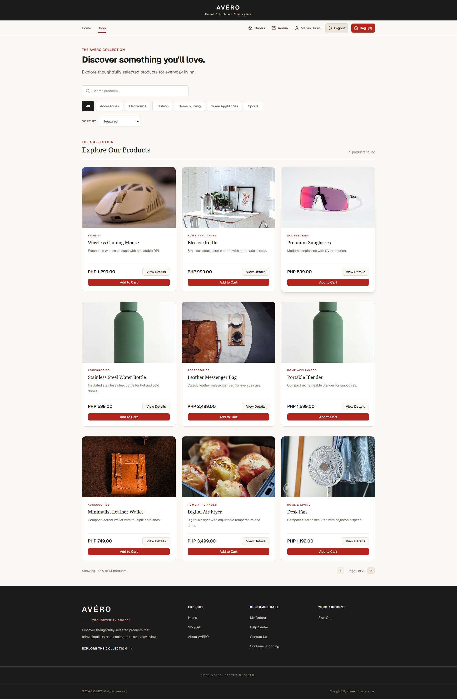
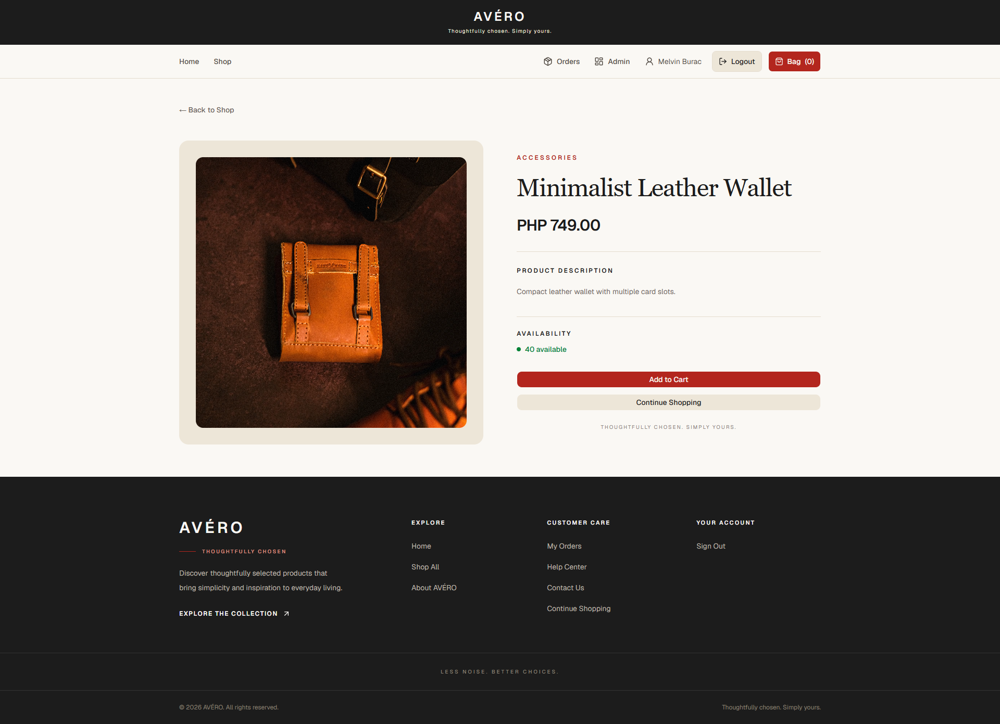
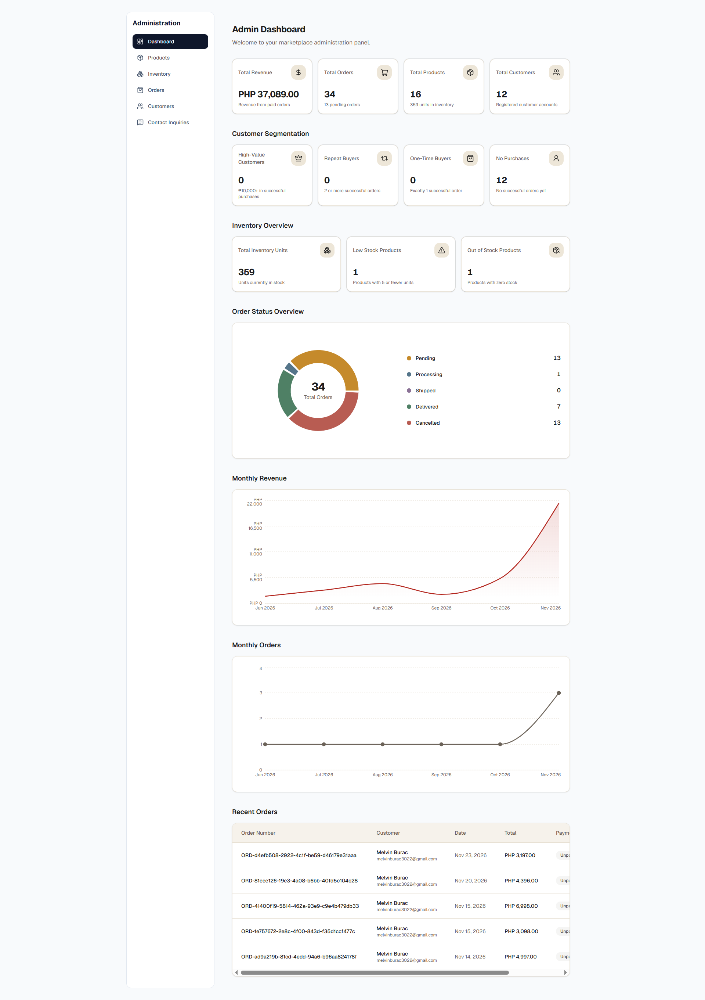
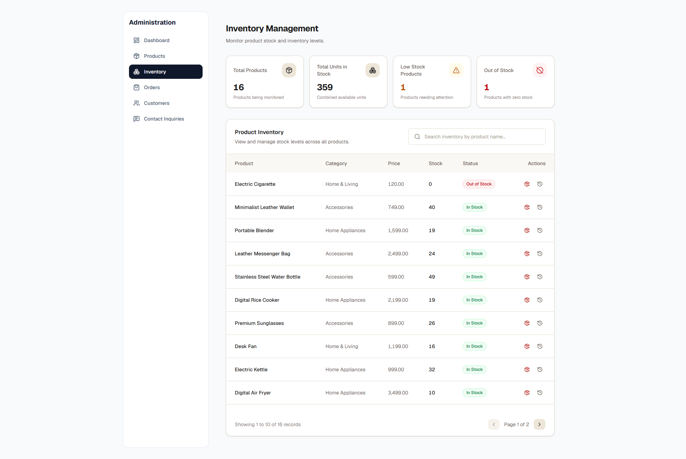
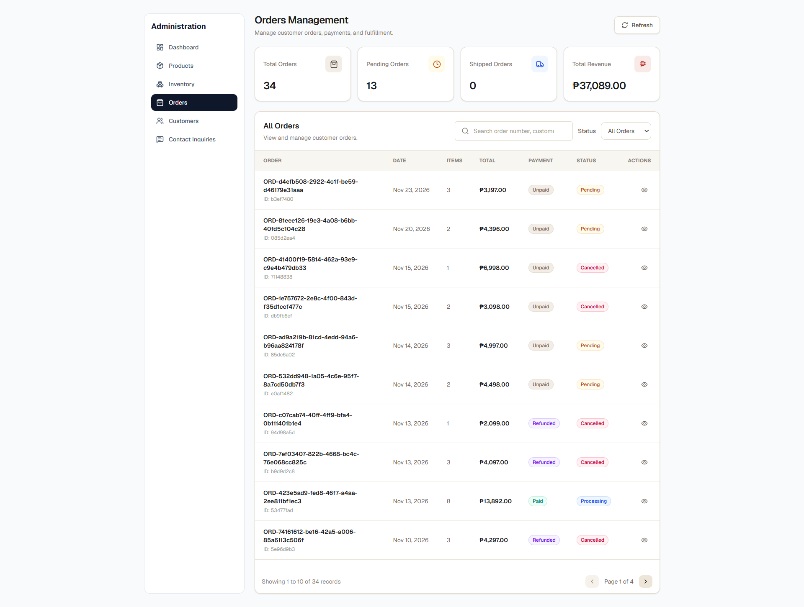

# AVÉRO — E-Commerce Marketplace

A full-stack e-commerce marketplace built with React, Node.js, Express, and PostgreSQL. AVÉRO features a customer-facing storefront and an administrative dashboard for managing products, inventory, orders, payments, customers, and contact inquiries.

**Live Application:** https://avero-marketplace.vercel.app/

**Backend API:** https://avero-marketplace-api.vercel.app/

**GitHub Repository:** https://github.com/Melvin-12143031/avero-marketplace

---

## Demo Accounts

Use the following accounts to explore the application's customer and administrative features.

### Customer Account

| Field    | Details                       |
| -------- | ----------------------------- |
| Name     | Demo Customer                 |
| Email    | `demo.customer@avero.example` |
| Password | `demo.customer123`            |
| Role     | Customer                      |

**Available features:**

- Browse the product catalog
- Search, filter, sort, and view products
- Manage a shopping cart
- Complete checkout
- View order history and order details
- Access customer features

### Administrator Account

| Field    | Details                    |
| -------- | -------------------------- |
| Name     | Demo Admin                 |
| Email    | `demo.admin@avero.example` |
| Password | `demo.admin123`            |
| Role     | Administrator              |

**Available features:**

- View the administrative dashboard
- Manage products and categories
- Manage inventory and stock adjustments
- Manage customer orders
- Review payment records
- Manage customer accounts
- View customer order history
- Manage contact inquiries

> **Demo account notice:** These credentials are intended exclusively for application evaluation. The administrator account should only be enabled against an isolated demonstration environment with sample data. Do not use these credentials with production customer information.

---

## Project Overview

AVÉRO is a full-stack marketplace application designed to demonstrate an end-to-end e-commerce workflow.

The application separates the customer storefront from administrative operations while using a centralized backend API and PostgreSQL database.

The project focuses on:

- Structured frontend and backend architecture
- Authentication and role-based authorization
- Database-driven business workflows
- Inventory and order consistency
- Administrative management features
- Secure API request handling
- Production deployment using Vercel

---

## Screenshots

### Customer Storefront



### Product Catalog



### Product Details



### Admin Dashboard



### Inventory Management



### Order Management



## Features

### Customer Storefront

- Customer registration and authentication
- Product catalog and category browsing
- Product search
- Category filtering
- Product sorting and pagination
- Product details
- Shopping cart management
- Checkout and order creation
- Order confirmation
- Customer order history
- Order status tracking
- Invoice generation
- Customer wishlist
- Product reviews for eligible customers
- Contact inquiry submission

### Administrative Dashboard

- Dashboard statistics and visual reports
- Product creation, editing, and management
- Product activation and deactivation
- Category management
- Inventory monitoring
- Stock-in and stock-out adjustments
- Low-stock and out-of-stock monitoring
- Order management
- Order status transitions
- Payment record and history management
- Customer listing and search
- Customer details and order history
- Customer account deactivation and reactivation
- Contact inquiry management
- Customer data export

### Security and Validation

- JWT-based authentication
- HTTP-only authentication cookies
- Password hashing with bcrypt
- Role-based authorization
- Protected frontend routes
- Protected backend endpoints
- Zod request validation
- Express rate limiting
- Helmet security headers
- CORS configuration
- Image file validation and processing
- Centralized error handling
- Environment variable validation

---

## Technology Stack

| Category         | Technologies             |
| ---------------- | ------------------------ |
| Frontend         | React 19, React Router 7 |
| Build Tool       | Vite 8                   |
| Styling          | Tailwind CSS 4           |
| UI Components    | Base UI, shadcn          |
| Charts           | Recharts                 |
| Icons            | Lucide React             |
| Notifications    | Sonner                   |
| PDF Generation   | pdfMake                  |
| Backend          | Node.js, Express 5       |
| Database         | PostgreSQL               |
| Database Hosting | Neon                     |
| Database Driver  | node-postgres (`pg`)     |
| Authentication   | JSON Web Tokens, bcrypt  |
| Validation       | Zod                      |
| Image Storage    | Cloudinary               |
| Image Processing | Sharp                    |
| File Uploads     | Multer                   |
| Deployment       | Vercel                   |

---

## Application Architecture

AVÉRO uses a separated frontend and backend architecture.

**Frontend:** React application responsible for the storefront, customer interactions, and administrative interface.

**Backend:** Express API responsible for authentication, authorization, business logic, validation, and database operations.

**Database:** PostgreSQL hosted on Neon.

**Image Storage:** Cloudinary.

**Deployment:** Frontend and backend are deployed as separate Vercel projects.

General request flow:

```text
Customer / Administrator
          |
          v
     React Frontend
          |
          v
       API Layer
          |
          v
    Express Backend
          |
          v
       Middleware
          |
          v
      Controllers
          |
          v
       Services
          |
          v
    PostgreSQL (Neon)
```

---

## Project Structure

```text
ecommerce-marketplace/
│
├── api/
│   ├── config/
│   ├── controllers/
│   ├── middleware/
│   ├── routes/
│   ├── services/
│   ├── validators/
│   ├── server.js
│   ├── package.json
│   └── .env.example
│
├── public/
│
├── quiries/
│   └── Database SQL scripts
│
├── src/
│   ├── app/
│   ├── assets/
│   ├── components/
│   ├── features/
│   ├── hooks/
│   ├── lib/
│   ├── pages/
│   ├── services/
│   ├── utils/
│   ├── App.jsx
│   ├── index.css
│   └── main.jsx
│
├── .env.example
├── .gitignore
├── .vercelignore
├── components.json
├── jsconfig.json
├── package.json
├── vercel.json
└── README.md
```

---

## Getting Started

### Prerequisites

Install the following before setting up the project:

- Node.js
- npm
- A PostgreSQL database
- A Cloudinary account

### 1. Clone the Repository

```bash
git clone https://github.com/Melvin-12143031/avero-marketplace.git

cd avero-marketplace
```

### 2. Install Frontend Dependencies

From the project root:

```bash
npm install
```

### 3. Install Backend Dependencies

```bash
cd api
npm install
cd ..
```

### 4. Configure Environment Variables

Create a `.env` file in the project root using `.env.example`.

```env
VITE_API_BASE_URL=/api
```

Create an `api/.env` file using `api/.env.example`.

```env
PORT=5000
NODE_ENV=development

DATABASE_URL=your_database_url_here

JWT_SECRET=your_secure_jwt_secret
JWT_EXPIRES_IN=1d

CLOUDINARY_CLOUD_NAME=your_cloudinary_cloud_name
CLOUDINARY_API_KEY=your_cloudinary_api_key
CLOUDINARY_API_SECRET=your_cloudinary_api_secret

CLIENT_URL=http://localhost:5173
```

Replace all placeholder values with your own credentials.

**Important:** Never commit `.env` files or expose database credentials, JWT secrets, or Cloudinary API secrets in source control.

### 5. Configure the Database

Create a PostgreSQL database and configure its connection string in `api/.env`.

The project's SQL scripts are maintained in the `quiries/` directory. Execute the required schema creation and refinement scripts against your database in the appropriate order.

### 6. Start the Backend

Open a terminal in the `api/` directory:

```bash
npm run dev
```

### 7. Start the Frontend

Open a separate terminal in the project root:

```bash
npm run dev
```

Open the local Vite URL displayed in the terminal, normally:

```text
http://localhost:5173
```

---

## API Overview

All API routes use the `/api` prefix.

| Resource          | Endpoint          |
| ----------------- | ----------------- |
| Authentication    | `/api/auth`       |
| Products          | `/api/products`   |
| Categories        | `/api/categories` |
| Shopping Cart     | `/api/cart`       |
| Orders            | `/api/orders`     |
| Payments          | `/api/payments`   |
| Inventory         | `/api/inventory`  |
| Dashboard         | `/api/dashboard`  |
| Customers         | `/api/customers`  |
| Contact Inquiries | `/api/contact`    |

### Health Check Endpoints

```http
GET /api/health
GET /api/health/db
```

The first endpoint checks API availability. The second checks database connectivity.

---

## Deployment

AVÉRO is deployed through two separate Vercel projects connected to the same GitHub repository.

### Frontend Deployment

| Setting          | Value           |
| ---------------- | --------------- |
| Root Directory   | `./`            |
| Framework        | Vite            |
| Build Command    | `npm run build` |
| Output Directory | `dist`          |

Frontend environment variable:

```env
VITE_API_BASE_URL=/api
```

### Backend Deployment

| Setting        | Value       |
| -------------- | ----------- |
| Root Directory | `api/`      |
| Runtime        | Node.js     |
| Entry Point    | `server.js` |

Backend environment variables:

```env
DATABASE_URL=your_neon_database_url
JWT_SECRET=your_secure_jwt_secret
JWT_EXPIRES_IN=1d
CLIENT_URL=https://avero-marketplace.vercel.app

CLOUDINARY_CLOUD_NAME=your_cloudinary_cloud_name
CLOUDINARY_API_KEY=your_cloudinary_api_key
CLOUDINARY_API_SECRET=your_cloudinary_api_secret

NODE_ENV=production
```

The root `vercel.json` configuration forwards frontend `/api` requests to the separately deployed backend.

### External Services

- **Vercel:** Frontend and backend hosting
- **Neon:** Managed PostgreSQL database
- **Cloudinary:** Product image storage and delivery

---

## Available Scripts

### Frontend

Run these commands from the project root.

| Command           | Description                       |
| ----------------- | --------------------------------- |
| `npm run dev`     | Start the Vite development server |
| `npm run build`   | Generate the production build     |
| `npm run preview` | Preview the production build      |
| `npm run lint`    | Run ESLint                        |

### Backend

Run these commands from the `api/` directory.

| Command       | Description                               |
| ------------- | ----------------------------------------- |
| `npm run dev` | Start the development server with Nodemon |
| `npm start`   | Start the backend using Node.js           |

---

## Known Limitations

- **Payment processing:** Payment functionality is simulated. No live payment gateway is integrated.
- **Contact email integration:** Contact inquiries are stored and managed through the application. Automatic email acknowledgments and two-way email communication are not integrated.
- **External services:** A developer setting up a separate instance must provide their own Neon and Cloudinary accounts and credentials.
- **Automated testing:** This project has not been documented as having an automated test suite. Its completed verification has primarily involved manual functional testing.

---

## License

No open-source license has been specified for this repository. Unless a license is added, reuse and redistribution are subject to the applicable copyright rules.

---

**AVÉRO — A modern e-commerce marketplace.**
